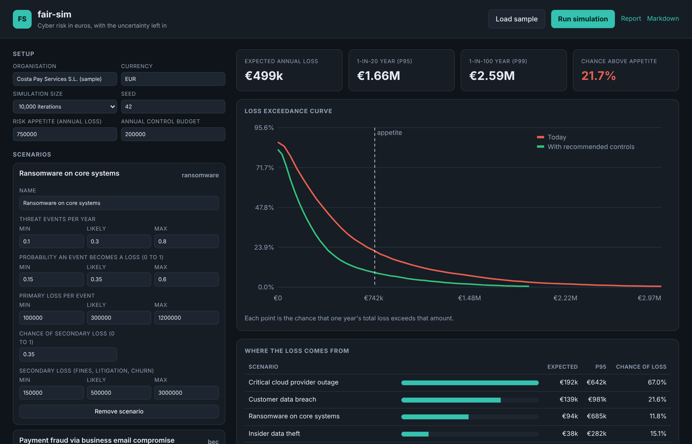
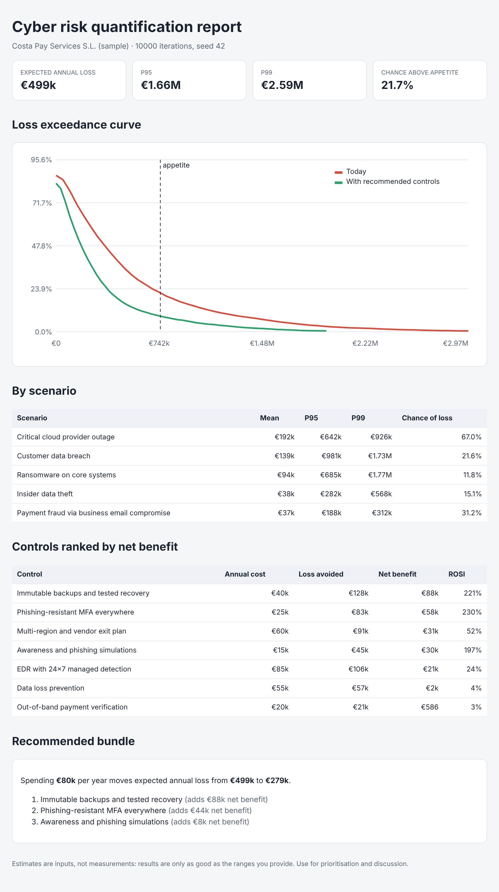

# fair-sim

Cyber risk in euros, with the uncertainty left in. A dependency-free **Python** implementation of FAIR-style risk quantification: you give three-point estimates (min, most likely, max) for how often something happens and what it costs, and a Monte Carlo simulation returns expected annual loss, the 1-in-20 and 1-in-100 year loss, the chance of exceeding your risk appetite, and which controls pay for themselves.

> Built with AI assistance (Claude) as a portfolio project. The sample numbers are fictional. Results are only as good as the estimates you feed in.



## Why

"High, medium, low" risk matrices cannot answer a CFO's questions: how much could we lose, how likely is that, and is this 85k euro tool worth it? Quantification can, as long as the model is honest about uncertainty. This project keeps the model small enough to audit in an afternoon (about 300 lines for the engine) and shows its work.

## Quick start

Python 3.11+, standard library only.

```bash
python3 -m unittest discover -s tests          # 35 tests
python3 -m fairsim serve                       # web UI on http://127.0.0.1:8600
python3 -m fairsim run samples/costa-pay.json  # Markdown report on stdout
python3 -m fairsim run samples/costa-pay.json --format html > report.html
python3 -m fairsim run samples/costa-pay.json --format json
python3 -m fairsim validate my-input.json
python3 -m fairsim run my-input.json --max-prob-over-appetite 0.05   # exit code 2 when above, usable as a gate
```

## The model

For each scenario and each simulated year:

1. Draw **threat event frequency** (events per year) and **vulnerability** (probability an event becomes a loss) from modified PERT distributions built from your min, most likely and max.
2. The number of loss events is Poisson with rate `frequency x vulnerability`.
3. Each loss event costs a **primary loss** (PERT) plus, with some probability, a **secondary loss** (fines, litigation, churn).
4. Portfolio loss is the sum across scenarios. Output: mean, median, P90, P95, P99, the **loss exceedance curve** and the probability of exceeding your appetite.



### Control what-if with common random numbers

Each control reduces event **frequency**, **vulnerability** (how often attempts succeed) or **magnitude** (size of the loss) for the scenarios it applies to. Every what-if run reuses the *same* random draws as the baseline, and the event count is sampled by inverse CDF, so a control can only remove events, never add them. The difference between two runs is therefore the effect of the control, not simulation noise, and tests assert this property iteration by iteration.

* **Net benefit** = expected loss avoided - annual cost. **ROSI** = net benefit / cost.
* The **recommended bundle** is built greedily: keep adding the control with the best marginal net benefit (re-simulated with the controls already chosen, so overlaps are not double counted) while it stays inside the budget and still pays off.

## Input

```json
{
  "organisation": "Costa Pay Services S.L.",
  "currency": "EUR", "iterations": 10000, "seed": 42,
  "appetite": 750000, "budget": 200000,
  "scenarios": [{
    "id": "ransomware", "name": "Ransomware on core systems",
    "tef": {"min": 0.1, "mode": 0.3, "max": 0.8},
    "vulnerability": {"min": 0.15, "mode": 0.35, "max": 0.6},
    "primary_loss": {"min": 100000, "mode": 300000, "max": 1200000},
    "secondary": {"probability": 0.35, "loss": {"min": 150000, "mode": 500000, "max": 3000000}}
  }],
  "controls": [{
    "id": "backups", "name": "Immutable backups", "annual_cost": 40000,
    "applies_to": ["ransomware"], "magnitude_reduction": 0.45
  }]
}
```

A bare number means a fixed value. Reductions are fractions from 0 to 1. Omit `applies_to` to apply a control to every scenario. Inputs are validated strictly (ordering of min/mode/max, ranges, finite numbers, unique ids, size limits).

## Security design

* The UI binds to **127.0.0.1 only** and rejects any other `Host` header (DNS rebinding).
* `POST /api/simulate` requires a custom header, `application/json`, and a same-origin `Origin` when one is sent (CSRF). Bodies are capped at 256 KB and the API caps simulation size at 50,000 iterations.
* Strict CSP on the app (no inline script or style); the generated report is a script-free page.
* The UI renders with `textContent` only and a test fails the build if an HTML injection sink or remote URL appears.
* No cookies, no network calls, no telemetry. Reports escape all user-supplied text.

## Layout

```
fairsim/model.py     input model and validation
fairsim/engine.py    PERT sampling, inverse-CDF Poisson, common random numbers, bundle search
fairsim/report.py    Markdown and HTML reports with inline SVG charts
fairsim/server.py    loopback web server (http.server)
fairsim/cli.py       run, validate, serve
fairsim/web/         UI (HTML, CSS, JavaScript)
samples/             fictional fintech example
tests/               unittest suite
```

## Limits

Monte Carlo cannot fix bad inputs: wide ranges give wide answers, and scenarios are assumed independent (no correlation between, say, ransomware and outage). Frequency and loss ranges should come from incident history, industry data and calibrated expert estimates. Use the output to prioritise and to explain trade-offs, not as a forecast.

MIT licensed.
